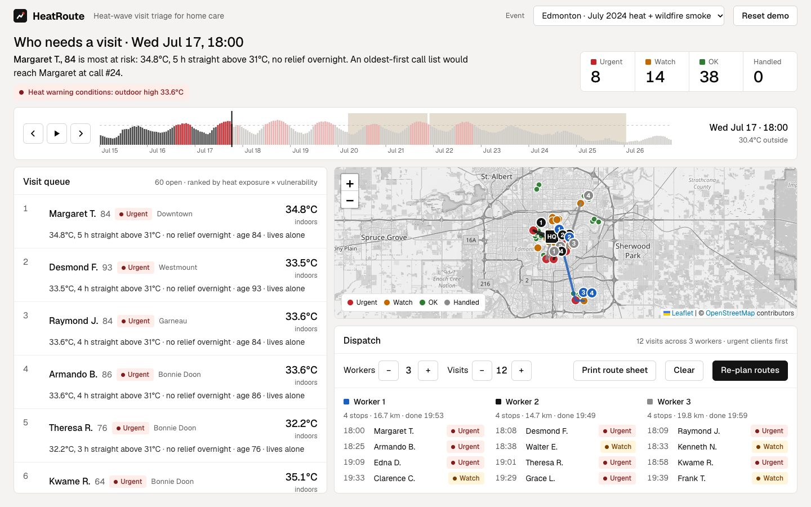

# HeatRoute

**Heat-wave visit triage for home care coordinators.** HeatRoute combines how hot each client's home has been with how vulnerable each client is, ranks everyone by urgency with a plain-language reason, and plans a visit route for each worker on shift. Logging a visit re-ranks the queue.

natHacks 2026 · Standard Division · Healthcare & Accessibility

**Live demo:** _add the Render URL here after the first deploy_ · **Written summary:** [docs/summary.md](docs/summary.md) · **Pitch script:** [docs/pitch.md](docs/pitch.md)



---

## The problem

Extreme heat kills people indoors, quietly, one at a time. In the 2021 Western Canada heat dome, BC's coroner counted **619 heat deaths: 98% died indoors, 67% were 70 or older, 56% lived alone.** The same heat dome broke temperature records across Alberta. In July 2024, Edmonton went through a week of 33–35°C days and then **wildfire smoke**, the same week the Jasper wildfire started. Smoke makes heat worse indoors: public health advice is to keep windows shut, which takes away the only night cooling a home without air conditioning has.

The people who decide who gets a visit, home care coordinators, still work from a phone list, usually oldest first. Age alone is a weak guide. A 91-year-old in a ground-floor, north-facing unit with AC is safe. An 84-year-old alone on the sixth floor, south-facing with no AC, is not.

## What HeatRoute does

One screen answers three questions:

1. **Who is in danger right now?** Every client ranked by an urgency score, with a red / amber / green band shown in colour *and* words.
2. **Why?** Up to four reasons per client, e.g. `34.8°C, 5 h straight above 31°C · no relief overnight · age 84 · lives alone`.
3. **What should workers do next?** Visit routes for the workers on shift, with ETAs, on a map. Logging a visit ("checked OK", "moved to cooling centre", "called 911") re-ranks the queue at once.

Beyond the core:

- **Wildfire smoke as a compound hazard.** Smoke hours close windows in the thermal model, and add risk for clients with COPD, asthma or heart disease (`smoke + COPD`).
- **6-hour forecast.** Each client shows whether they will turn urgent in the next six hours, so workers go before a home turns red.
- **Phone-list comparison.** Each client's position on an oldest-first call list is shown beside their HeatRoute rank.
- **Three real events, one codebase:** Edmonton July 2024 (heat + smoke), Edmonton June 2021 heat dome, Metro Vancouver June 2021 heat dome.
- **Printable route sheet** for workers without the app.

### Headline results (from the model, on real weather)

| Scenario, moment | Urgent clients | Of those, reached in the first *N* calls of an oldest-first list | Calls to reach all of them |
| --- | ---: | ---: | ---: |
| Edmonton, Jul 17 2024, 18:00 | 8 | 1 of 8 | 58 |
| Edmonton, Jul 22 2024, 15:00 (smoke) | 18 | 5 of 18 | 58 |
| Edmonton, Jun 30 2021, 18:00 | 18 | 6 of 18 | 58 |
| Metro Vancouver, Jun 28 2021, 18:00 | 19 | 6 of 19 | 58 |

During the July 2024 smoke, the average overnight low inside no-AC homes rose from 27.5–28.5°C (Jul 18–19) to 31.3–31.5°C (Jul 22–23), while outdoor night lows rose only 2–3°C. Margaret, the demo's anchor client, is #1 in HeatRoute and #24 on the phone list.

These are simulated homes driven by real weather, not measured outcomes. Validating them against real indoor sensors is step one of the pilot plan below.

## Demo (5 minutes)

Open the app (it starts at **Edmonton · July 2024**). Any moment can be bookmarked: the URL carries the scenario, time, open client and routes.

1. **Jul 15, 09:00:** everyone is green.
2. Click **Margaret T.**: 84, sixth floor, south-facing, no AC, lives alone, heart disease.
3. Drag to **Jul 16, 12:00**. Margaret is still green, but her row says *Forecast: urgent by 18:00*. A worker can go before her home turns dangerous.
4. Drag to **Jul 17, 18:00**. Margaret is #1 at 34.8°C indoors. **Gordon B.**, 91 (ground floor, north-facing, AC), stays green, older but safe. The top line reads: *an oldest-first call list would reach Margaret at call #24.* Of the 8 urgent clients, the phone list's first 8 calls reach one.
5. Drag to **Jul 21, 12:00**. The smoke notice appears. **Walter K.**, 77, COPD, is on watch with `smoke + COPD` and forecast urgent by 18:00. By Jul 22 the urgent count has grown from 8 to 18.
6. Click **Plan routes** with 3 workers: each worker's first stop is one of the three most urgent clients; routes and ETAs show on the map.
7. Open Margaret and press **Moved to cooling centre**: she drops to *Handled*, and the queue and routes re-rank.
8. Switch **Event** to Metro Vancouver 2021: same people, same tool, different city.

**Reset demo** clears the visit log, so the sequence runs the same way every time. Direct link to the key moment: `/?scenario=edmonton_2024&t=2024-07-17T18:00`.

## How to run

Needs Python 3.11+ and Node 20+.

```bash
make setup     # venv + pip install, npm install
make dev       # API on :8000 and frontend on :5173 (open http://localhost:5173)
make test      # 39 tests: simulator, risk engine, routing, and the demo sequence end to end
```

Production, as deployed: `make build && make api` serves everything on `:8000`, or `make docker` builds and runs the exact image Render runs. Frontend only, no backend: `cd frontend && VITE_USE_MOCKS=1 npm run dev` (renders the contract fixtures).

### Deploy (Render, free)

`render.yaml` is a Render Blueprint. In Render: **New → Blueprint**, pick this repository, apply. It builds the `Dockerfile` (Node builds the frontend, Python serves the API and the static files from one origin) and health-checks `/api/health`. The visit log is SQLite in `/tmp`; it resets when the free instance sleeps, which suits a demo. API docs are at `/docs`.

## Technical decisions

```
data/weather_<scenario>.csv   real ECCC hourly temperature + smoke flag
        │
sim/      thermal model → indoor °C per home per hour (precomputed at startup)
          roster → 60 synthetic clients, same people in every city
        │
backend/  risk engine (pure functions) → score, band, reasons, 6 h forecast
          routing (pure functions) → runs per worker with ETAs
          FastAPI + SQLite visit log; serves the built frontend in production
        │
frontend/ React + TypeScript · Leaflet · Recharts
```

### Weather data: real, and chosen with care

`data/fetch_weather.py` downloads Environment Canada hourly bulk data and writes the CSVs; outputs are committed so the demo never depends on the network. If a file is missing, `sim/weather.py` falls back to a synthetic heat-wave curve and logs a warning.

| Scenario | Temperature station | Smoke flag station | Why |
| --- | --- | --- | --- |
| Edmonton 2024 | Edmonton Blatchford (27214) | Edmonton Intl A (50149) | Blatchford is central and urban, so it captures the heat island where clients live; only the airport records present weather, including "Smoke". |
| Edmonton 2021 | Edmonton Blatchford | Edmonton Intl A | Same city, the 2021 heat dome. |
| Metro Vancouver 2021 | Pitt Meadows CS (6830) | Vancouver Intl A (51442) | The airport is ocean-cooled (peak 32°C) and undersells the event; Pitt Meadows hit 41°C. Clients are placed in the Tri-Cities and Maple Ridge to match. |

ECCC reports in Local Standard Time; we add 1 h for daylight time, which is the clock a coordinator reads. ECCC only reports present weather in some hours, so an observed smoke hour keeps the advisory in effect for 12 h.

### Thermal model (`sim/thermal.py`)

A first-order model, one Euler step per hour:

```
T_in[t+1] = T_in[t] + (T_out[t] − T_in[t]) / τ_eff + solar(t) + internal + stack − AC
```

| Parameter | Value | Reason |
| --- | --- | --- |
| τ (time constant) | poor 6 h · average 10 h · good 14 h | How fast a home follows the outdoors; better envelopes respond slower. |
| Night cooling | τ × 1.0 with windows open; **τ × 2.0 during smoke** | Smoke advice closes windows; the home loses its night flush. |
| Solar gain | 0.32 °C/h peak at ~13:00 × orientation (N 0.5, E 0.9, S 1.3, W 1.4) × insulation (1.3 / 1.0 / 0.65) × 1.8 if top floor | Sun on roofs and south/west walls drives afternoon peaks. |
| Stack effect | +0.025 °C/h per floor, up to 8 floors | Heat rising through apartment buildings: upper units run hotter. |
| AC | caps indoor at 24.5°C | |
| Start | 22°C with a 72 h spin-up before the slider's first hour | Removes start-up artefacts. |

It is calibrated to be plausible, not exact: a no-AC top-floor unit peaks at 34–36°C on a 34°C day and stays above 28°C overnight; an AC home holds 24.5°C. Real-sensor calibration is pilot step 1.

### Risk engine (`backend/app/risk.py`, weights in `backend/app/config.py`)

- **Exposure** over the last 24 h, in degree-hours: `E = Σ [max(0, T−26) + 2·max(0, T−31)]`, plus 10 if the home never dropped below 26°C overnight (00:00–06:00). 26°C and 31°C are the BC Centre for Disease Control's indoor thresholds: above 26°C people begin to be affected; above 31°C is dangerous for susceptible people. The overnight bonus is there because the body recovers at night; hot nights without relief are a recognised driver of heat deaths.
- **Vulnerability** points: age 70+ +2 (85+ +3), lives alone +2, no AC +2, each chronic condition +1 (max 3), limited mobility +1, cognitive impairment +1, and **+2 for a lung or heart condition while smoke is present.** Living alone and no AC carry the most weight: living alone stood out in the BC coroner's review, and air conditioning is the most reliable protection indoors.
- **Score** = `100 × E_norm × (1 + V/5) / 3.4`, where `E_norm = 1 − e^(−E/120)`. Exposure gates the score, so a frail person in a cool home scores zero. Vulnerability multiplies it. The soft saturation keeps the hottest homes distinguishable from each other instead of all tying at 100.
- **Escalation:** any run of 3+ hours at ≥31°C in the last 24 h, for someone who lives alone, forces the band red and the client to the top.
- **Bands:** red ≥ 60 or escalated · amber ≥ 25 · green below.
- **Reasons:** the temperature fact first, then smoke, then no overnight relief, then person factors by weight; four at most. Every rank can be explained from what is on the row.
- **Visit outcomes:** *checked OK* lowers the score for 4 h; *moved to cooling centre* replaces home temperatures with 22°C until 08:00 next day; *called 911* removes the client from the queue.
- **Forecast:** the same score at t + 6 h. In a deployment, Environment Canada's hourly forecast feeds the same thermal model.

### Routing (`backend/app/routing.py`)

Each worker is seeded with one of the K most urgent clients, so the worst cases are reached first. The rest of the top N (default 12) are taken in rank order and given to the worker whose run currently ends nearest, with a load cap. Greedy nearest-neighbour orders each run. Plain round-robin by rank is also planned, and the shorter plan wins. On our scenarios proximity wins about 11 times in 12 and saves 10–30% of driving. Distances are haversine × 1.3 (a common straight-line-to-road factor) at 30 km/h with 20 minutes per visit. Straight lines keep it offline and instant; a road router (OSRM) or OR-Tools VRP is a drop-in replacement for one function.

### Why these tools

FastAPI + Pydantic so the contract is enforced in code and documented at `/docs`. Pure-function risk and routing modules so every rule is unit-tested; `backend/tests/test_api.py` plays the full demo as a test. SQLite for the visit log: zero setup and enough for one agency. React + Leaflet + Recharts on the frontend, with OpenStreetMap tiles shown in greyscale so colour on the map always means risk.

## Designed for coordinators

The user is a coordinator at a desk during a long, stressful shift, and often has to explain decisions to a supervisor or a family.

- **One screen.** The queue, the map and the routes are visible together at 1440 × 900; nothing important is behind a tab.
- **Colour carries no meaning alone.** Every band is a word ("Urgent", "Watch", "OK") next to its colour, safe for colour-blind users and readable in print. The interface itself is ink on stone: the only colour on screen is risk, smoke, and route data.
- **A reason on every row,** in plain words, so a rank can be defended out loud.
- **Large, calm type:** 15–18px body, tabular figures so temperatures line up.
- **Keyboard first:** the time strip is a real slider (arrow keys step an hour), ↑/↓ moves through the queue, Enter opens a client, Esc closes. Every control has a visible focus ring and an accessible name; screen readers hear the time and temperature as the slider moves.
- **Forgiving:** moving the slider back hides visits logged later; *Reset demo* clears the log.
- **Works without the app:** the route sheet prints cleanly for workers in the field.
- **Responsive** down to phone width for a supervisor checking in.

## Path to a pilot

| Step | What | Constraint it addresses |
| --- | --- | --- |
| 1. Validate | Put low-cost indoor temperature loggers (about $30 each) in 20–30 consenting clients' homes for one summer; compare with the model; refit τ and gains. | Is the simulated indoor temperature close enough? |
| 2. Live data | Replace the replay with Environment Canada's hourly observations and forecast (MSC Datamart/GeoMet, free). Homes with sensors use measured temperatures; the rest use the model. | Real-time operation without hardware in every home. |
| 3. Clinical review | Review the vulnerability weights and thresholds with home care nurses and a public health physician; keep every weight in one config file. | Weights are evidence-informed, not clinically validated. |
| 4. Partner | Pilot with one Alberta home care provider or regional health operator in Edmonton for one heat season, alongside the existing phone list. Measure time-to-first-visit for high-risk clients. | Adoption and evidence of benefit. |
| 5. Privacy | Host in Canada; minimum data (no diagnoses beyond risk flags); role-based access and audit log; privacy impact assessment under Alberta's Health Information Act. | Health information. |
| 6. Integrate | Import the client list from the agency's scheduling system (CSV first); road routing (OSRM) and OR-Tools VRP with time windows; SMS check-ins for clients who can answer. | Fitting the existing workflow. |

Running cost for one agency is a small cloud instance plus optional loggers. The software is open source.

## Data sources and credits

- Weather: Environment and Climate Change Canada, Historical Climate Data, hourly observations, stations 27214, 50149, 6830, 51442 (Open Government Licence – Canada).
- Heat mortality statistics: BC Coroners Service, *Extreme Heat and Human Mortality: A Review of Heat-Related Deaths in B.C. in Summer 2021* (2022).
- Indoor temperature thresholds: BC Centre for Disease Control guidance on indoor overheating (26°C and 31°C).
- Heat warning criterion (29°C daytime high): Environment and Climate Change Canada's Alberta heat warning criteria.
- Map tiles and data: © OpenStreetMap contributors.
- Libraries: FastAPI, Pydantic, Uvicorn, React, Vite, Leaflet, react-leaflet, Recharts. Typeface: Geist.
- **All clients are synthetic.** Names, ages, conditions and locations are invented; no real patient data is used.

## Team

| Name | Field | Role |
| --- | --- | --- |
| Divyesh Challa | _field_ | _role_ |
| _teammate_ | _field_ | _role_ |
| _teammate_ | _field_ | _role_ |

## Repository

```
data/       weather CSVs + fetch script        sim/       weather, thermal model, roster, tests
backend/    FastAPI app, risk, routing, tests  frontend/  React app
contract/   API contract + fixtures            docs/      written summary, pitch script
```
